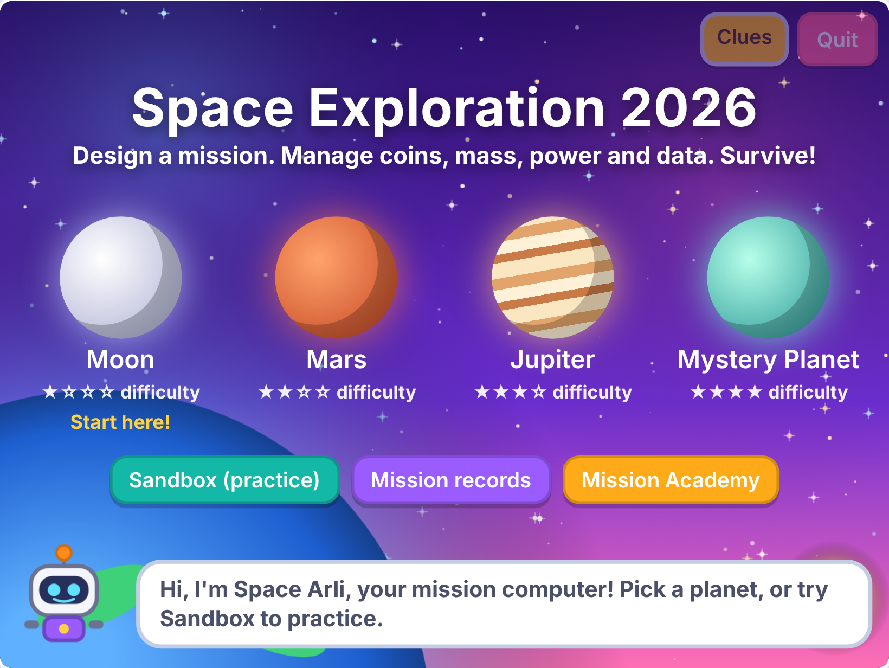
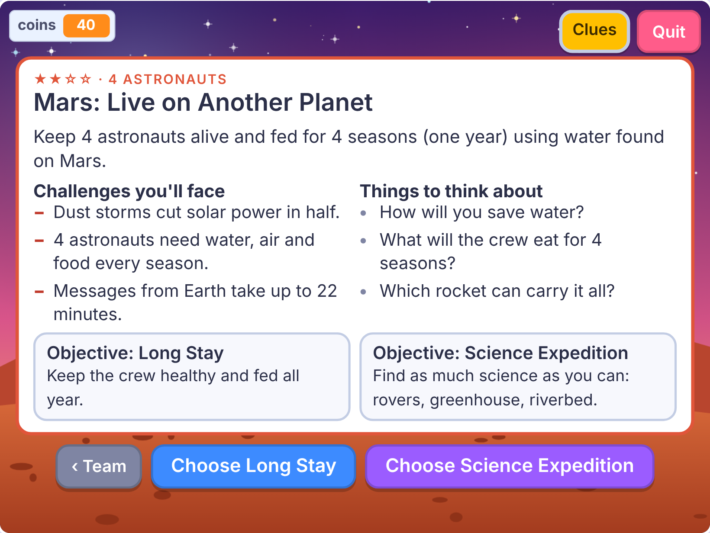
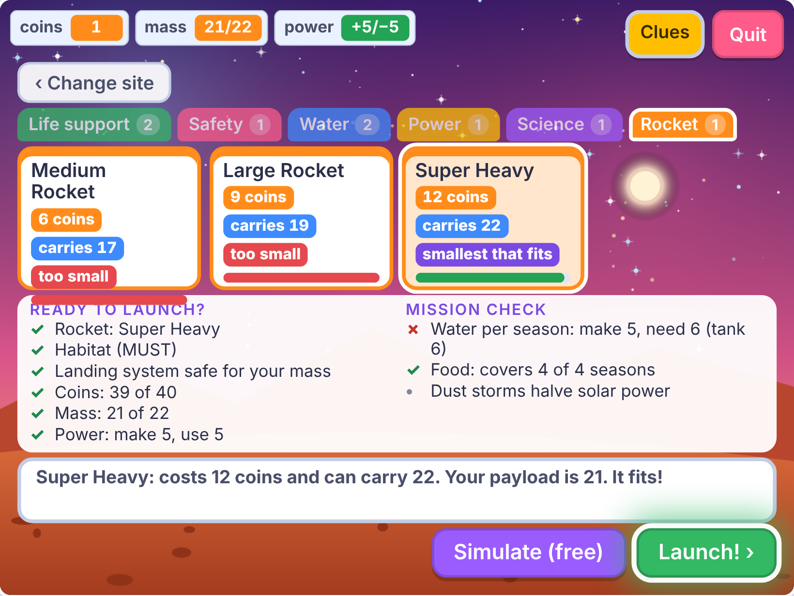
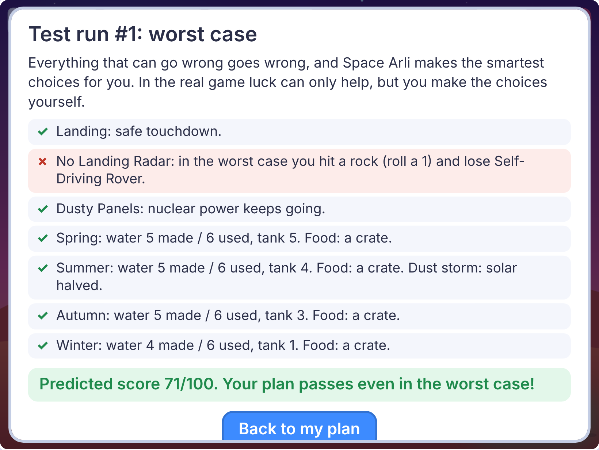
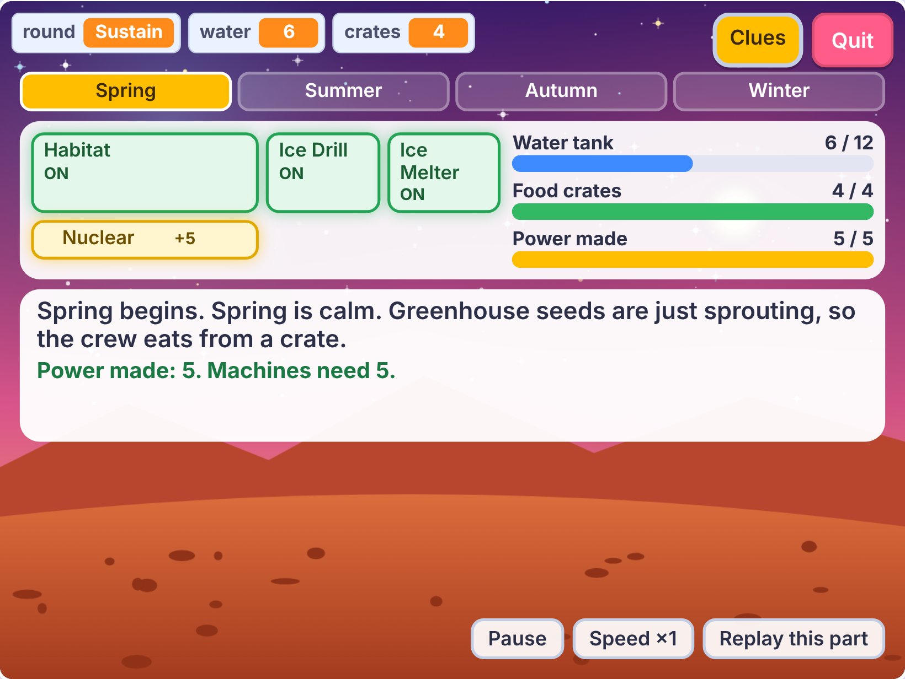
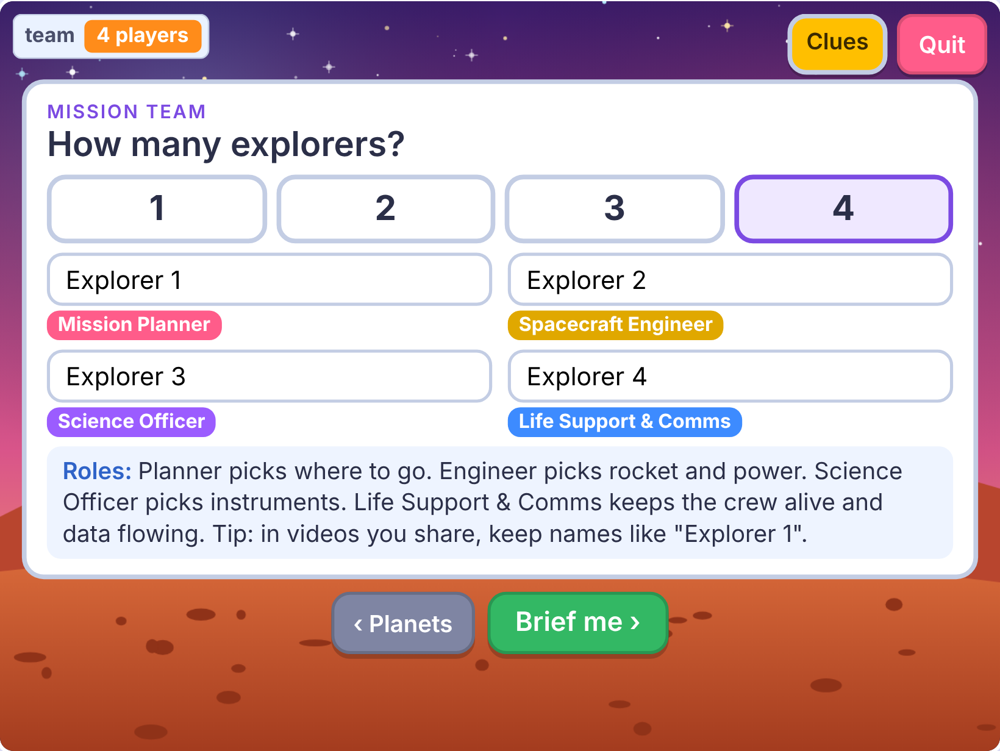
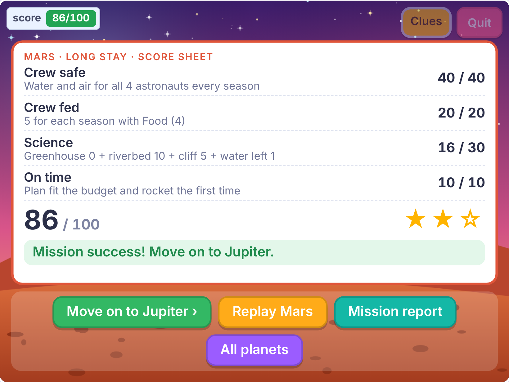

# Space Exploration 2026

**A space mission design game for kids.** Pick a planet, plan your mission, pack your rocket, and keep your crew or robot alive.

Built for the **NASA Space Apps Challenge 2026**, challenge: [Space Mission Design Game](https://www.spaceappschallenge.org/2026/challenges/space-mission-design-game/).

## Play it

- **Online:** turn on GitHub Pages for this repo (Settings → Pages → Deploy from branch → `main`, folder `/root`), then open `https://<your-username>.github.io/<repo-name>/`.
- **Offline:** download `index.html` and open it in any web browser. No install, no internet needed (fonts fall back to system fonts when offline).

Best on a laptop or tablet.

## How it works

Pick one of 4 destinations, easiest to hardest:

| Destination | Who goes | The big challenge |
|---|---|---|
| Moon | 2 astronauts | The 14-day lunar night |
| Mars | 4 astronauts | Water, air and food for a whole year |
| Jupiter's moons | A robot | Radiation, and sending data home |
| Mystery Planet | Telescopes | Is there life? Read the clues like a scientist |

Every mission has 4 rounds:

1. **Research:** pick a landing site (and an orbit on Jupiter).
2. **Prepare:** pack parts within your coins, your rocket's mass limit and your power. Test your plan with **Simulate**.
3. **Explore:** surprise events, such as dust storms, solar flares and rocky landings.
4. **Sustain:** an animated story of your mission. It stops when you must decide.

You score out of 100. Score 60 or more to move on; stars at 60, 75 and 90. Every planet has many different winning plans, and every option can win with the right thinking.

## Features

- Mission Academy intro, plus a "Your job now" box on every screen that says what to do and why
- Team mode for 1–4 players with roles: Mission Planner, Spacecraft Engineer, Science Officer, Life Support & Comms
- 2 mission objectives per planet, which change how points are scored
- Resource management: coins, mass, power (day and night), water, food, robot Health and data
- Simulate: a worst-case test run before launch (first test free, then 1 coin)
- Clues button (hints only when you ask), Space words glossary, Read to me
- Mission report at the end (copy and share), mission records on this computer
- Sandbox mode with unlimited coins for experimenting

## Screenshots

| | |
|---|---|
|  |  |
|  |  |
|  |  |

## Files

| File | What it is |
|---|---|
| `index.html` | The whole game in one file (HTML, CSS and JavaScript, no libraries) |
| `docs/GAME_DESIGN.md` | Rules, numbers and scoring for every planet |
| `SOURCES.md` | Science sources and third-party licenses |
| `screenshots/` | Pictures of the game |
| `LICENSE` | MIT License |

## Science and sources

Game facts are simplified from NASA, JPL, MIT and STScI sources: Moon ice in dark craters, the 14-day lunar night, Mars launch windows, NASA's MOXIE oxygen maker, Juno's radiation vault, Europa Clipper's looping orbit, and Webb studying TRAPPIST-1e. The Mystery Planet clues are pretend; no planet beyond Earth has confirmed signs of life. Full list in [SOURCES.md](SOURCES.md).

## Credits

Game idea, planets, events and playtesting by the Space Exploration 2026 team, with adult guidance. Code written with help from Claude, an AI assistant. Fonts: Fredoka and Nunito from Google Fonts (SIL Open Font License).

## License

[MIT](LICENSE)
